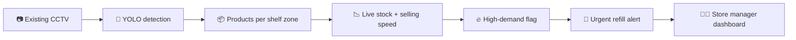

<p align="center">
  
</p>

<p align="center">
  <a href="https://shelfora-peach.vercel.app"></a>
  <a href="docs/shelfora-linkedin-4x5.mp4"></a>
</p>

<p align="center">
  
  
  
  
  
  
  
</p>

<p align="center">
  <b>Shelfora turns the CCTV cameras a store already has into live shelf inventory.</b><br>
  It counts every product on the shelf, notices what's selling fast,<br>
  and tells the store manager what to refill first, before customers walk out empty-handed.
</p>

---

## 🛒 The problem

A customer comes in for juice, finds an empty shelf, and leaves. Nobody notices until the end of the
day. Stock counts in most stores lag hours behind what's actually on the shelf, and the products
that run out first are usually the ones selling best.

## 💡 How Shelfora works



1. **See:** the store's existing camera watches the shelf. No new hardware.
2. **Count:** a YOLO11 model finds every product; each product has a shelf zone, so detections become a live stock count.
3. **Understand:** when items leave a zone quickly, Shelfora flags them as high demand.
4. **Act:** an empty high-demand shelf raises an urgent refill alert, ranked by priority, so staff know what to restock first.

## ✨ Features

<table>
  <tr>
    <td width="50%"><br><b>Overview</b><br>What needs you right now, shelf health, a live store map and the storefront view.</td>
    <td width="50%"><br><b>Live Monitor</b><br>Camera views with a detection box on every product: green stocked, amber low, red empty.</td>
  </tr>
  <tr>
    <td width="50%"><br><b>Refill Queue</b><br>Ranked by 50% stock level + 30% selling speed + 20% time until empty.</td>
    <td width="50%"><br><b>Guided refill round</b><br>Walks staff through urgent shelves one at a time, with the camera view and map.</td>
  </tr>
  <tr>
    <td width="50%"><br><b>Vision Model</b><br>Accuracy, training curve and the model's boxes on shelf photos it has never seen.</td>
    <td width="50%"><br><b>Dark mode</b><br>Plus ⌘K search, alerts, fast movers, shelf health and analytics.</td>
  </tr>
</table>

<p align="center"><br><sub>Works on phones too, so floor staff can use the refill round in the aisle.</sub></p>

## 🤖 The model

YOLO11n, fine-tuned on public retail-shelf data:

| Dataset | What it teaches |
|---|---|
| **Grocery Dataset** (Varol & Kuzu): 354 shelf photos, 13,184 labelled products | Find every product facing on a shelf |
| **Retail Shelf Void Detection** (Kaggle) | Spot empty gaps on shelves |

| Metric (held-out shelf photos) | Before training | After training |
|---|---|---|
| mAP50 | 41.7% | **99.4%** |
| mAP50-95 | 22.1% | **74.3%** |
| Precision | 58.1% | **99.6%** |
| Recall | 30.6% | **99.8%** |

> **Honest note:** the held-out photos come from the same stores as the training photos, so expect
> lower scores in a new store. Frames from that store's own cameras improve it most. Both datasets are
> licensed for research / non-commercial use and are not included here; download them with
> `vision-server/scripts/get_data.py`.

## 🚀 Run it locally

<details open>
<summary><b>Dashboard</b> (Node.js 20+)</summary>

```bash
cd dashboard
npm install
npm run dev
```
Open http://localhost:5173. It runs on sample data out of the box.
</details>

<details>
<summary><b>Vision server</b> (Python 3.12)</summary>

```bash
cd vision-server
pip install fastapi "uvicorn[standard]" pyyaml numpy opencv-python-headless
python -m uvicorn shelfora.api:app --port 8000
```
Then in the dashboard go to **Settings → Connect your store** and enter `http://localhost:8000`.
With no camera configured it runs a simulated shop where shelves empty on their own.
Real cameras, calibration and training: see [`SETUP_GUIDE.md`](SETUP_GUIDE.md) and
[`vision-server/TRAINING.md`](vision-server/TRAINING.md).
</details>

<details>
<summary><b>Make a demo video from your own shelf</b></summary>

```bash
python vision-server/scripts/make_demo_video.py --video shelf.mp4 --names "Chips,Biscuits,Juice"
```
Draws coloured zones, a dot on each product, live counts, high-demand tags and refill alerts.
</details>

## 🗂️ Project structure

```
shelfora/
├── dashboard/              React + TypeScript + Tailwind web app for store managers
│   └── src/                pages, components, refill-priority logic, sample store data
├── vision-server/          Python + FastAPI service
│   ├── shelfora/           camera reader, detector, shelf-zone counting, sales, API
│   ├── models/             trained YOLO11n shelf model
│   ├── scripts/            datasets, training, calibration, demo video
│   ├── notebooks/          Google Colab notebooks (training, demo video)
│   └── tests/              unit and API tests
└── docs/                   banner, screenshots, demo video
```

## 🛣️ Roadmap

- [x] Store-manager dashboard with refill priority, alerts and analytics
- [x] Vision server with shelf-zone counting and a simulated shop
- [x] Model trained on real shelf photos and empty-shelf data
- [x] High-demand detection and urgent refill alerts
- [ ] Pilot with real store CCTV footage
- [ ] Fine-tune on Indian retail products
- [ ] Connect to POS / billing systems for live sales

## 👩‍💻 Author

Built by **Nancy Verma**: [GitHub](https://github.com/nancy-verma780)

If Shelfora is interesting to you, a ⭐ on the repo helps a lot, and feedback is very welcome.
